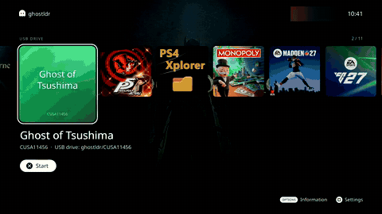

# ghostldr

ghostldr runs PS4 game dumps and OpenOrbis homebrew inside *Star Wars Racer Revenge* (SWRR) on a stock PS4/PS5. It uses [Luac0re](https://github.com/Gezine/Luac0re)'s userland exploit: no kernel exploit, no jailbreak.

[](docs/media/ghostldr-demo.mp4?raw=true)

[Full demo, 3½ minutes (MP4)](docs/media/ghostldr-demo.mp4?raw=true): from Luac0re's loader to Ghost's gameplay.

## What you need

- A PS5 on firmware 13.60 or later.
- SWRR, US (CUSA03474) or EU (CUSA03492), with Luac0re 2.4b working.
- Your own game dump: a folder with `eboot.bin` in it. No game files are included.
- An exFAT USB drive for the games (recommended). Without one, games can be installed into SWRR's saved data over the network.
- One of these, to start ghostldr:
  - the release's autoloader save on the console (it needs Save Wizard, or a jailbroken PS4 with Apollo Save Tool, once);
  - a computer or phone that can send a file over the network (`nc`, or a payload-sender app).

No Python and no program on a computer.

## What works

- **Ghost of Tsushima v2.18** (CUSA11456) plays. It is the most tested title.
- **Bloodborne 1.09** (CUSA00900) plays: loading, playing and saving.
- **OpenOrbis homebrew** runs, and **Apollo Save Tool** runs on your saves.
- **Games run from a USB drive**, in folders of any name. No install step.
- **A game selector** with Settings: it checks your games and drives, installs games over the network, and comes back when a game ends.
- **An FTP server** on the PS5 while the selector or a game runs.
- **An ELF loader** for homebrew developers: send a payload, get its output back.
- **Every failure is explained on the TV**, and each boot's log is written to the USB drive.

Other games boot as far as their imports and memory allow. [docs/compatibility.md](docs/compatibility.md) has the details and the known limits.

## How to run it

Download the files from the [latest release](https://github.com/asylumexp/ghostldr/releases/latest), put your games on a USB drive, and start ghostldr in one of two ways:

- **The autoloader:** import the release's save once. After that, OPTIONS → HALL OF FAME in SWRR opens the game selector by itself.
- **Two files over the network:** send `ghostldr.lua` and `ghostldr-ext.bin` with `nc` or a payload-sender app. Later, `ghostldr.lua` alone.

[docs/using-the-release.md](docs/using-the-release.md) takes you through it step by step.

## Compatibility

- **PS5, firmware 13.60 and later:** supported, with US or EU SWRR.
- **PS4:** homebrew and small titles only. The PS4 gives SWRR 2.5 GiB of memory; Ghost needs about 4 GiB.
- **Jak X with UltraC0re** instead of SWRR: experimental.
- **PS5 games:** no. SWRR runs in PS4 mode.

## Documentation

- [Using the release](docs/using-the-release.md): download to gameplay, step by step.
- [Compatibility](docs/compatibility.md): what runs, PS4 and Jak X, Apollo, and the known limits.
- [Developers](docs/developers.md): the ELF loader, building payloads, title profiles, the tools on a computer, making a release.

## Building from source

You need macOS or Linux, Python 3.11+ and LLVM 18 (clang, ld.lld, llvm-objcopy, llvm-nm).

```bash
tools/fetch_deps.sh                            # PS4 symbol names and Luac0re 2.4b into build/
make -C ghostldr/native                        # LLVM=/path/to/llvm/bin for another LLVM than Homebrew's llvm@18
python3 -m unittest discover -s ghostldr/tests # offline; Lua 5.3 or 5.4 for the Lua tests
python3 tools/make_release.py --version v1.0.0 # the release's files in build/release/
```

The build writes `ghostldr.lua`, `ghostldr-ext.bin` and `ghostldr-elfldr.bin` to `build/ghostldr/`. [docs/developers.md](docs/developers.md) has the rest: the tools on a computer, the autoloader's saves, and the tests.

## License and credits

MIT, see [LICENSE](LICENSE). It covers ghostldr's own code only; Luac0re, ps4libdoc and ps5-payload-sdk keep their own licenses. The selector's built-in font is under the SIL Open Font License 1.1 ([OFL.txt](ghostldr/native/selector/font/OFL.txt)).

- [Luac0re](https://github.com/Gezine/Luac0re), by Gezine and contributors (MIT).
- [mast1c0re](https://github.com/McCaulay/mast1c0re), by CTurt and McCaulay.
- PS4 symbol names from [idc/ps4libdoc](https://github.com/idc/ps4libdoc).
- [ps5-payload-sdk](https://github.com/ps5-payload-dev/sdk), by John Törnblom (dev payloads only).
- [Noto Sans](https://github.com/notofonts/latin-greek-cyrillic), by the Noto Project Authors (the selector's font).
- [shadPS4](https://github.com/shadps4-emu/shadPS4), used only as a reference for how system functions behave. No shadPS4 code is included.
